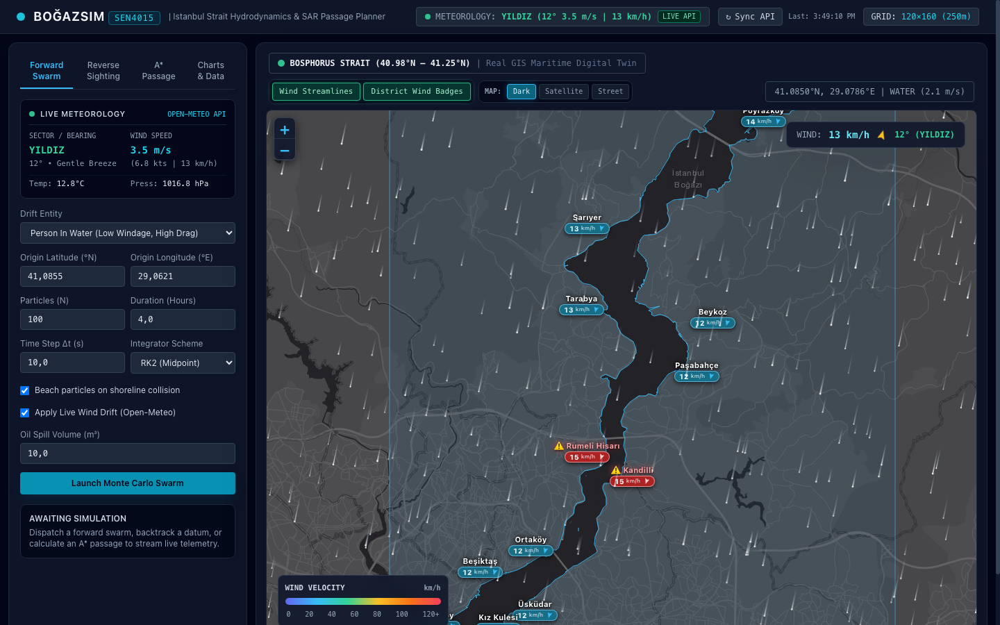
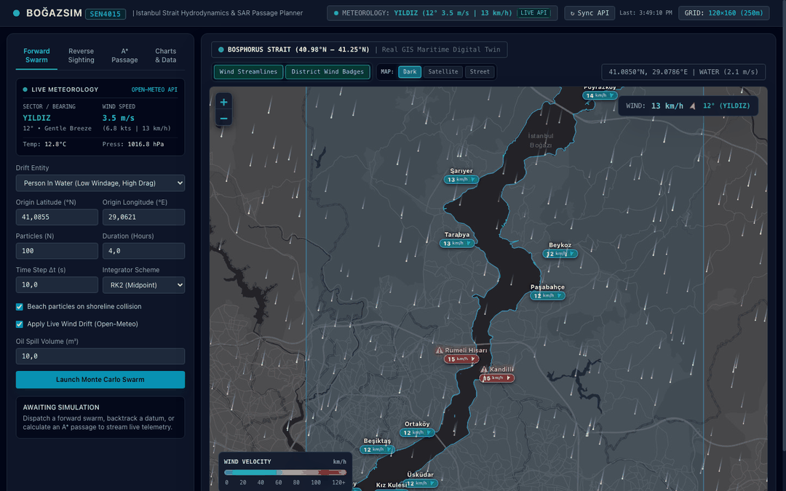

# BoğazSim — Istanbul Bosphorus SAR Swarm & Vessel Routing Simulator

[](https://www.python.org/)
[](https://fastapi.tiangolo.com/)
[-brightgreen.svg)]()
[]()

**BoğazSim** is an interactive maritime simulation environment and mission-control digital twin for the Istanbul Strait (Bosphorus). Developed as a university senior capstone project for SEN4015 (Advanced Programming with Python), it combines computational hydrodynamics, Lagrangian stochastic particle tracking for Search and Rescue (SAR), backward-in-time datum backtracking, and optimal vessel passage planning through one of the world's most congested and navigationally challenging maritime chokepoints.


*Interactive mission-control digital twin displaying live Open-Meteo wind vectors, coastal district telemetry badges, and the Bosphorus Strait navigation channel.*


*Animated demonstration: switching between live monitoring, Monte Carlo forward particle swarms, reverse datum backtracking with 95% confidence ellipses, and optimal A\* vessel routing.*

---

## Key Features

- **Hydrodynamic Vector Grid**: $120 \times 160$ discrete cell spatial model capturing two-layer stratified currents, Rumeli Hisarı Venturi constriction acceleration, and localized coastal counter-eddies (*Girdaplar*) with continuous 2D bilinear interpolation.
- **Monte Carlo Lagrangian Swarm Tracking**: Second-order Runge-Kutta (RK2 Midpoint) and Euler integrators modeling leeway drift deflection, Coriolis rotation, Brownian turbulent diffusion, and Fay gravity-viscous oil slick spreading.
- **Reverse Datum Backtracking ($- \Delta t$)**: Inverts time integration backward from last-known sightings to estimate candidate origin zones, bounded by analytical $95\%$ bivariate confidence dispersion ellipses.
- **Continuous Collision Detection (CCD)**: OpenStreetMap polygon boundaries paired with a uniform spatial hash grid index guarantee that particle trajectories and routes remain in navigable water.
- **Weighted A\* Vessel Route Optimization**: Graph navigation on a Moore 8-neighborhood that optimizes vessel Speed Over Ground (SOG) and balances head-current fuel penalties ($\lambda_{\text{head}}$), smoothed via line-of-sight raycasting.
- **FastAPI REST Application**: Asynchronous service with 10 REST endpoints, Pydantic v2 schemas, background thread workers, and thread-safe simulation state locking.
- **Interactive Maritime Digital Twin**: Single-page Leaflet and HTML5 Canvas interface featuring live Open-Meteo weather polling, synthetic fallback generators, and publication figure generation.

---

## Quickstart & Installation

### Prerequisites
- Python 3.11+ (Tested on Python 3.11 and Python 3.13 on macOS arm64 / Linux x86_64)
- Modern web browser (Chrome, Safari, Firefox, Edge)

### Setup Instructions
```bash
# 1. Clone repository and navigate to workspace
git clone https://github.com/Nadir31337/Bogazsim.git
cd Bogazsim

# 2. Create and activate virtual environment
python3 -m venv .venv
source .venv/bin/activate

# 3. Install pinned dependencies
pip install -r requirements.txt

# 4. Run test suite
python -m pytest -q

# 5. Launch FastAPI Mission-Control Server
python -m uvicorn main:app --host 127.0.0.1 --port 8000 --reload
```
Open **`http://127.0.0.1:8000`** in your browser to interact with the mission-control dashboard.

### Generate 300-DPI Publication Figures
```bash
# Generates all 6 publication charts into report_assets/
python generate_report_assets.py
```

---

## System Architecture

```mermaid
graph TD
    Client["Mission-Control Browser Client (HTML5 Canvas / Leaflet GIS)"]
    
    subgraph FastAPI["FastAPI Application (ASGI Server)"]
        API["REST Router (10 Endpoints)"]
        Lock["SimulationStateManager (threading.Lock)"]
        Singletons["Lazy Singletons (VectorGrid, Visualizer, Processor)"]
    end

    subgraph Physics["Computational Hydrodynamics Engine"]
        VG["VectorGrid (120x160 Cells, Bilinear Interpolation)"]
        Geo["BosphorusGeographicService (OSM Polygons & CCD)"]
        Fwd["ForwardSwarmSimulator (RK2 / Euler Monte Carlo)"]
        Rev["ReverseTracker (Time-Inverted Datum Search)"]
        AStar["RouteOptimizer (Weighted A* Navigation)"]
        WX["WeatherAPIClient (Open-Meteo & Synthetic Fallback)"]
    end

    subgraph DataEngine["Analytics & Visualization"]
        DP["SimulationDataProcessor (Pandas / Haversine / Rolling)"]
        Vis["MaritimeVisualizer (Matplotlib Agg / Seaborn Dark)"]
    end

    Client -->|GET /api/grid, /api/weather, /api/geojson/coastline| API
    Client -->|POST /api/simulate/forward| API
    Client -->|POST /api/simulate/reverse| API
    Client -->|POST /api/route| API
    Client -->|GET /api/analytics/chart/{name}| API
    Client -->|GET /api/export/csv| API

    API --> Lock
    API --> Singletons
    Singletons --> VG
    Singletons --> Geo
    Singletons --> Fwd
    Singletons --> Rev
    Singletons --> AStar
    Singletons --> WX
    Singletons --> DP
    Singletons --> Vis
```

---

## Physical & Mathematical Formulations

### 1. Venturi Throat Acceleration
Across a channel of variable width $W(y)$, mass conservation under shallow-water assumptions dictates:

$$V_{\text{surface}}(y) = V_{\min} + (V_{\max} - V_{\min}) \cdot \left(\frac{W_{\min}}{W(y)}\right)$$

In the Rumeli Hisarı constriction ($W_{\min} \approx 700\text{ m}$ at $41.0855^\circ\text{N}$), surface speed accelerates to $2.5\text{ m/s}$ ($4.86\text{ knots}$), while widening to $3500\text{ m}$ at both channel entrances drops current velocity to $1.0\text{ m/s}$.

### 2. Runge-Kutta 2nd Order (Midpoint) Numerical Integration
For particle position $\mathbf{x}(t)$ advecting in a velocity field $\mathbf{V}(\mathbf{x}, t)$:

$$\mathbf{k}_1 = \mathbf{V}(\mathbf{x}_n)$$

$$\mathbf{k}_2 = \mathbf{V}\left(\mathbf{x}_n + \frac{\Delta t}{2}\mathbf{k}_1\right)$$

$$\mathbf{x}_{n+1} = \mathbf{x}_n + \Delta t \, \mathbf{k}_2$$

RK2 eliminates first-order Taylor truncation error, yielding $\mathcal{O}(\Delta t^2)$ local convergence.

### 3. Courant-Friedrichs-Lewy (CFL) Condition

$$\mathcal{C} = \frac{V_{\max} \Delta t}{\Delta x_{\min}} = \frac{2.5\text{ m/s} \times 10.0\text{ s}}{131.0\text{ m}} \approx 0.19$$

A Courant number of about 0.19 keeps particles from skipping grid cells and helps accuracy; it is not a strict stability guarantee for particle tracking.

### 4. 95% Bivariate Confidence Datum Ellipse
For $N$ backtracked terminal particle positions with spatial sample covariance $\boldsymbol{\Sigma}$:

$$\boldsymbol{\Sigma} = \frac{1}{N-1}\sum_{i=1}^N (\mathbf{p}_i - \bar{\mathbf{p}})(\mathbf{p}_i - \bar{\mathbf{p}})^T, \quad \boldsymbol{\Sigma}\mathbf{v}_i = \lambda_i \mathbf{v}_i$$

Using the $95\%$ bivariate chi-squared critical value $\chi^2_{2, 0.95} = -2\ln(0.05) \approx 5.991$:

$$a = \sqrt{5.991 \cdot \lambda_1}, \quad b = \sqrt{5.991 \cdot \lambda_2}$$

### 5. Weighted A\* Head-Current Cost Function
With vessel speed through water $V_s$ and edge unit vector $\hat{\mathbf{u}}$:

$$V_{\text{ground}} = V_s + \mathbf{V}_{\text{current}} \cdot \hat{\mathbf{u}}$$

$$\text{Cost} = \Delta t \cdot \left(1.0 + \lambda_{\text{head}} \cdot \max\left(0, -\frac{\mathbf{V}_{\text{current}} \cdot \hat{\mathbf{u}}}{V_s}\right)^2\right), \quad \Delta t = \frac{\|\mathbf{d}\|}{V_{\text{ground}}}$$

The heuristic:

$$h(n) = \frac{\text{Distance}_{\text{Euclidean}}(n, \text{goal})}{V_s + V_{\max}^{\text{current}}}$$

provides an admissible lower bound on edge traversal time under non-negative fuel penalties.

---

## REST API Reference

The FastAPI application provides 11 endpoints serving JSON data, GeoJSON geometry, rendered HTML, Base64 charts, and dynamic CSV downloads:

| HTTP Method | Endpoint Path | Summary | Key Parameters | Success Response |
|:---:|:---|:---|:---|:---|
| `GET` | `/` | Web Dashboard | None | `200 OK` (HTML5 single-page mission control) |
| `GET` | `/api/health` | Node Health | None | `200 OK` (`status`, `uptime_seconds`, `grid_rows`, `memory_rss_mb`) |
| `GET` | `/api/weather` | Live Meteorology | `force_refresh` (bool) | `200 OK` (`speed_ms`, `direction_deg`, `sector_name`, `source`) |
| `GET` | `/api/grid` | Vector Grid Data | None | `200 OK` (`bounds`, `constriction`, `downsampled_vectors`) |
| `GET` | `/api/geojson/coastline` | Shoreline Polygons | None | `200 OK` (GeoJSON FeatureCollection) |
| `POST` | `/api/simulate/forward` | Forward Swarm | `ForwardSimulationRequest` | `200 OK` (`trajectories`, `beached_count`, `landing_heatmap`) |
| `POST` | `/api/simulate/reverse` | Reverse Backtrack | `ReverseSimulationRequest` | `200 OK` (`estimated_origins`, `confidence_ellipse_95_km`) |
| `POST` | `/api/route` | A\* Route Planner | `RouteRequest` | `200 OK` (`waypoints`, `total_distance_km`, `eta_minutes`, `fuel_proxy`) |
| `GET` | `/api/analytics/summary` | Simulation Summary | None | `200 OK` (Aggregated statistics for most recent simulation) |
| `GET` | `/api/analytics/chart/{name}` | Base64 Chart | `name` in `[quiver, windrose, heatmap, kde, distance_kde, route]` | `200 OK` (`image_base64`, `chart_name`, `mime_type`) |
| `GET` | `/api/export/csv` | CSV Telemetry Export | None | `200 OK` (`text/csv` attachment of simulation time-series) |

---

## Further Documentation

Detailed documentation, technical derivations, and oral defense materials are maintained in the **[`docs/`](docs/)** directory:
- **[`docs/RUBRIC_MATRIX.md`](docs/RUBRIC_MATRIX.md)** — Comprehensive SEN4015 capstone grading rubric verification matrix.
- **[`docs/ARCHITECTURE_AND_QA_GUIDE.md`](docs/ARCHITECTURE_AND_QA_GUIDE.md)** — Academic defense reference guide featuring 27 professor oral examination questions and answers.
